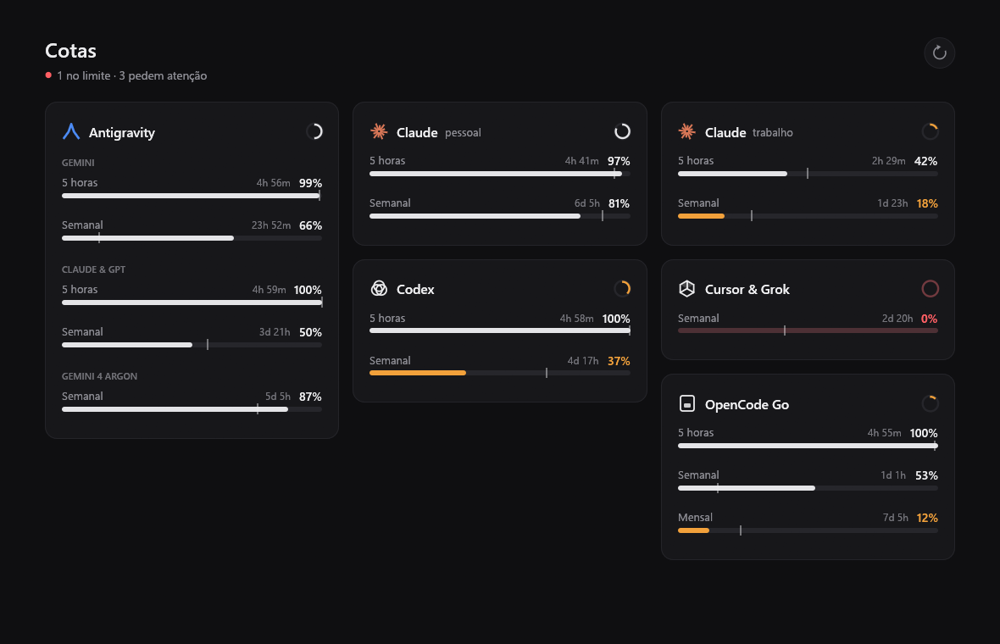

# AgentUsage

A desktop dashboard, written in Rust, that shows in real time how much quota each AI agent has
left: Antigravity, Claude (several accounts), Codex, Cursor & Grok and OpenCode Go.


## Download

**Windows (x64):** get `AgentUsage-v0.1.0-windows-x64.exe` from
[Releases](https://github.com/toshiotomikawa/AgentUsage/releases/latest) and run it. It is a single
portable file: no installer and no API keys, since it reads the logins your CLIs already keep. Run
it with `--demo` to see it with fictional data first.

The exe is not code-signed, so Windows SmartScreen may warn on first run: choose **More info**, then
**Run anyway**. `SHA256SUMS.txt` on the release page lets you check the file.

Other systems: build from source (see [Run](#run)). Only Windows is tested.

## How to read it

- **One row per quota window** (5 hours, weekly, monthly…), always as **% remaining**, with the
  time until it resets next to it.
- **Color shows the state:** green is on pace; amber asks for attention (usage ahead of pace, or
  little quota left on a window with no timer); wine is critical, below 10%; gray is exhausted until it resets.
- **Title bar menu:** language (PT-BR, EN-US), theme (system, light, dark), which cards to show,
  GitHub, and Update, which looks for a new version in the repository's releases. Choices are
  saved.
- **The tick on each bar marks the pace:** (hover to see the state) it is where the bar would be
  with even usage until the reset. A bar left of the tick means you are spending faster than time
  passes.
- The rings in the corner of each card show, from outside in, the hours, weekly and monthly
  windows (the tightest of each).
- All Claude accounts share one card, one section per account.
- Details stay hidden and appear on hover: the reset date and a forecast ("runs out in 2h 10m").
- Refreshes on its own every 20 s; Claude every 5 min, waiting longer when the service asks.
  **F5** or the reload button in the title bar ask for a fresh reading within those limits; a
  check mark confirms when it finishes.
- **Tray icon (Windows):** closing the window keeps the app in the tray. One click on the icon
  shows or hides the window; its menu has Open and End. Opening the app again brings the open
  window forward.



## Where the data comes from

The app reads the login each CLI already keeps on your machine and queries only that vendor's own
service. Tokens travel only over HTTPS, with no redirects, to the vendor's own service. When the
Claude login expires, the app renews it the way Claude Code does and writes it back to the same
file, without having to open Claude Code.

| Agent | Login read | Query |
| --- | --- | --- |
| Claude | `~/.claude/.credentials.json` (and `~/.claude-*`) | `api.anthropic.com/api/oauth/usage` |
| Codex | `~/.codex/auth.json` | `chatgpt.com/backend-api/wham/usage` |
| Cursor & Grok | `%APPDATA%/Cursor/auth.json` | `api2.cursor.sh` (DashboardService) |
| OpenCode Go | `~/.local/share/opencode` | `opencode.ai/zen/go/v1/usage` |
| Antigravity | `agy` session | `agy -p /usage --output-format json` (spends no tokens) |

## Configuration (optional)

`%APPDATA%\agent-usage\config.toml` on Windows (`~/.config/agent-usage/config.toml` on Linux):

```toml
claude_dirs = ["C:/Users/you/.claude-work"]  # other Claude Code account folders
antigravity = false                           # turns off the Antigravity reading
refresh_secs = 20
share_port = 47321                            # read-only snapshot for a phone app on 127.0.0.1; off unless set
```

## Run

```bash
cargo run --release
```

To see the interface with fictional data, without any login:

```bash
cargo run --release -- --demo
```

## Install on Windows

Builds the app, copies it to `%LOCALAPPDATA%\Programs\AgentUsage` and creates an "AgentUsage"
shortcut on the Desktop and in the Start menu. Run it again after updating the code.

```powershell
powershell -ExecutionPolicy Bypass -File scripts/install.ps1
```

## License

MIT
