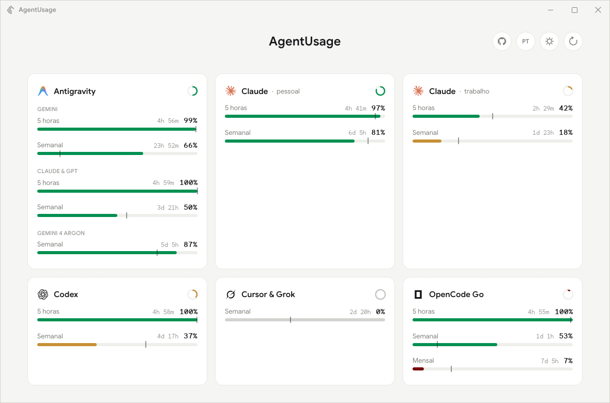

# AgentUsage

Desktop dashboard, in Rust, for the quota left on Antigravity, Claude (several accounts), Codex,
Cursor & Grok and OpenCode Go.

 

## Install

Windows x64: get the `-windows-x64.exe` from
[Releases](https://github.com/toshiotomikawa/AgentUsage/releases/latest) and run it. Portable,
no installer, no API keys: it reads the logins your CLIs already keep. `--demo` shows fictional
data. The exe is unsigned, so SmartScreen may warn (**More info**, **Run anyway**); check it
against `SHA256SUMS.txt`. Other systems: build from source, untested.

**Updates:** menu, **Update**. The first click checks; on Windows a second click downloads the
new exe, verifies its SHA-256 against GitHub's digest, swaps it in and restarts (elsewhere it opens
Releases).

## Reading it

- One row per quota window (5 h, weekly, monthly), as % remaining plus time to reset.
- Green: on pace. Amber: over 15% ahead of pace, or 25% or less with no reset timer. Wine: under
  10%. Gray: exhausted until reset.
- The tick on each bar is even-usage pace; a bar left of it is spending faster than time passes.
- Corner rings, outside in: hourly, weekly, monthly (tightest window of each).
- Hover: reset date and forecast ("runs out in 2h 10m").
- Refresh: every 20 s (minimum 15), Claude every 5 min (longer when the service asks); **F5**,
  **Ctrl+R** or the reload button force one within those limits.
- Windows tray: closing keeps it running; click the icon to show or hide; its menu has Open and End.
- Title-bar menu: language (PT-BR, EN-US), theme, visible cards, GitHub, Update. Saved.

## Data

Each login is read locally and sent only to that vendor, over HTTPS, without redirects. An
expired Claude login is renewed the way Claude Code does it and written back to the same file.

| Agent | Login read | Query |
| --- | --- | --- |
| Claude | `~/.claude/.credentials.json` (and `~/.claude-*`) | `api.anthropic.com/api/oauth/usage` |
| Codex | `~/.codex/auth.json` | `chatgpt.com/backend-api/wham/usage` |
| Cursor & Grok | `%APPDATA%/Cursor/auth.json` | `api2.cursor.sh` (DashboardService) |
| OpenCode Go | `~/.local/share/opencode` | `opencode.ai/zen/go/v1/usage` |
| Antigravity | `agy` session | `agy -p /usage --output-format json` (no tokens spent) |

## Config

Optional, `%APPDATA%\agent-usage\config.toml` (Linux: `~/.config/agent-usage/config.toml`):

```toml
claude_dirs = ["C:/Users/you/.claude-work"]  # extra Claude Code account folders
antigravity = false                           # skip Antigravity
refresh_secs = 20                             # minimum 15
share_port = 47321                            # read-only snapshot on 127.0.0.1; off unless set
```

## Build

```bash
cargo run --release              # add -- --demo for fictional data
```

`powershell -ExecutionPolicy Bypass -File scripts/install.ps1` builds, installs to
`%LOCALAPPDATA%\Programs\AgentUsage` and adds Desktop and Start menu shortcuts.

## License

MIT
