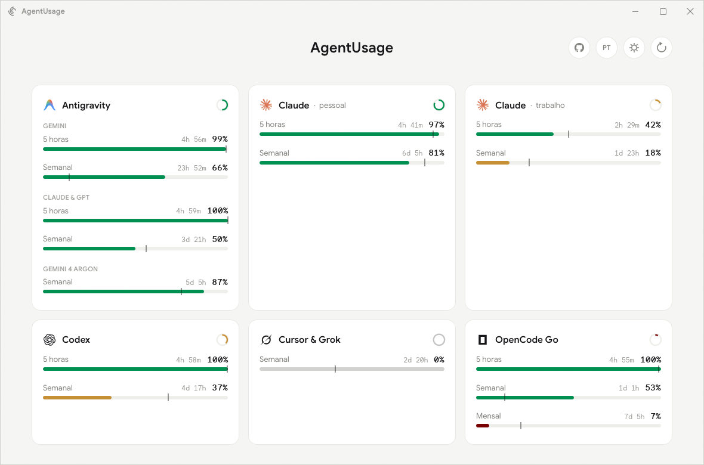
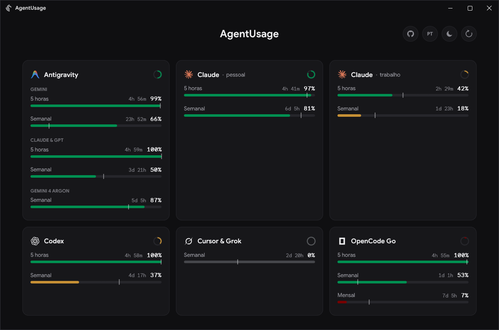

# AgentUsage

Painel de desktop, escrito em Rust, que mostra em tempo real quanto ainda resta da cota de cada
agente de IA: Antigravity, Claude (várias contas), Codex, Cursor & Grok e OpenCode Go.



## Como ler

- **Uma linha por janela de cota** (5 horas, semanal, mensal…), sempre em **% restante**,
  com o tempo até renovar ao lado.
- **A cor indica o estado:** verde está no ritmo; âmbar pede atenção (pouca cota ou consumo acima do
  ritmo); vinho fica crítica, abaixo de 10%; cinza está esgotada até renovar.
- **Tema e idioma:** os botões ao lado de Atualizar alternam o tema (sistema, claro, escuro) e o
  idioma (PT-BR, EN-US). A escolha fica salva. O botão do GitHub abre este repositório.
- **O risquinho na barra marca o ritmo:** (passe o mouse para ver o estado) é onde a barra estaria com um consumo uniforme até a
  renovação. Barra à esquerda do risco quer dizer que você está gastando mais rápido que o tempo.
- O anel no canto de cada cartão mostra a janela mais apertada daquela conta.
- Os detalhes ficam escondidos e aparecem ao passar o mouse: data da renovação e previsão
  ("acaba em 2h 10m").
- Atualiza sozinho a cada 60 s; o Claude, a cada 5 min, e espera mais quando o serviço pede.
  **F5** ou o botão no canto pedem uma leitura nova dentro desses limites.



## De onde vêm os dados

O app lê o login que cada CLI já guarda na sua máquina e consulta somente o serviço do próprio
fornecedor. Os tokens vão só por HTTPS, sem redirecionamento, ao serviço do próprio fornecedor.

| Agente | Login lido | Consulta |
| --- | --- | --- |
| Claude | `~/.claude/.credentials.json` (e `~/.claude-*`) | `api.anthropic.com/api/oauth/usage` |
| Codex | `~/.codex/auth.json` | `chatgpt.com/backend-api/wham/usage` |
| Cursor & Grok | `%APPDATA%/Cursor/auth.json` | `api2.cursor.sh` (DashboardService) |
| OpenCode Go | `~/.local/share/opencode` | `opencode.ai/zen/go/v1/usage` |
| Antigravity | sessão do `agy` | `agy -p /usage --output-format json` (sem gastar tokens) |

## Configuração (opcional)

`%APPDATA%\agent-usage\config.toml` no Windows (`~/.config/agent-usage/config.toml` no Linux):

```toml
claude_dirs = ["C:/Users/voce/.claude-trabalho"]  # outras pastas de conta do Claude Code
antigravity = false                                 # desliga a leitura do Antigravity
refresh_secs = 60
```

## Rodar

```bash
cargo run --release
```

Para ver a interface com dados fictícios, sem login nenhum:

```bash
cargo run --release -- --demo
```

## Instalar no Windows

Compila, copia o app para `%LOCALAPPDATA%\Programs\AgentUsage` e cria o atalho "AgentUsage" na Área de Trabalho e no Menu Iniciar. Rode de novo depois de atualizar o código.

```powershell
powershell -ExecutionPolicy Bypass -File scripts/install.ps1
```

## Licença

MIT
